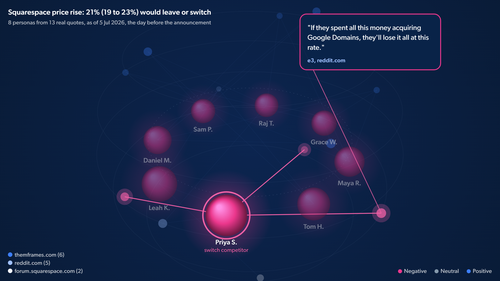

# greenroom

Rehearse a launch, pricing change or repositioning against simulated buyers built from real conversations.

```bash
npx greenroom run "Raise Pro from $49 to $79 per month" --audience "B2B marketing teams"
```

You get a report with the share of buyers who react badly, who would leave, the objections behind it with real quotes, and the changes that would soften it. Every persona is built from quotes pulled from Reddit, Hacker News, review sites and forums, or from your own support tickets and survey comments. Quotes that do not appear verbatim on the source page are thrown away.



The report above is a backtest: Heroku's 2022 removal of free plans, rehearsed with only what was published before the announcement. Full output in [examples/heroku-2022](examples/heroku-2022/report.md).

## For AI agents

| You are | Start here |
| --- | --- |
| An MCP client | `claude mcp add greenroom -- npx -y greenroom mcp`. The server sends its operating guide as MCP instructions. |
| An agent with a shell | `npx -y greenroom guide` prints the same guide. Every command below takes `--json`. |
| Claude Code with skills | Copy [skills/greenroom](skills/greenroom/SKILL.md) into `.claude/skills/`. |
| A coding agent changing this repo | [AGENTS.md](AGENTS.md) |

The guide covers the call order (doctor, estimate, start, status, report), how to write the seed, how to report results (median with range, confidence, quote URLs) and every error code.

## Pick your own backend

No API key is required if you already pay for Claude.

| Backend | Flag | Needs |
| --- | --- | --- |
| Claude subscription | `--llm claude-cli` | [Claude Code](https://claude.com/claude-code) installed and logged in |
| Anthropic API | `--llm anthropic` | `ANTHROPIC_API_KEY` |
| OpenAI | `--llm openai` | `OPENAI_API_KEY` |
| OpenRouter | `--llm openrouter` | `OPENROUTER_API_KEY` |
| Ollama or LM Studio | `--llm ollama` / `lmstudio` | local server |
| Any OpenAI-format endpoint | `--llm openai-compatible` | `LLM_BASE_URL`, `GREENROOM_MODEL_FAST` |
| Codex CLI, Gemini CLI | `--llm codex-cli` / `gemini-cli` | experimental |

Leave `--llm` out and greenroom picks the first one that works. Run `greenroom doctor` to see what is available.

`claude-cli` runs your own `claude` binary. greenroom never reads or stores your login. Each call is isolated (no tools, no MCP servers, no skills, no CLAUDE.md), because a default Claude Code call can load hundreds of thousands of tokens of personal context. An isolated call used about 1,400 input tokens in testing.

## Where the quotes come from

| Grounding | Flag | Notes |
| --- | --- | --- |
| [Bright Data](https://brightdata.com) | `--ground brightdata` | SERP API finds the threads, Web Unlocker reads pages that block ordinary requests. Set `BRIGHTDATA_API_KEY`. Optional `BRIGHTDATA_SERP_ZONE`, `BRIGHTDATA_UNLOCKER_ZONE`. |
| Plain fetch | `--ground local` | No search. Pass pages with `--urls` or files with `--evidence`. Sites that block bots will fail. |
| Off | `--ground none` | Evidence files only. |

Bring your own quotes with `--evidence ./quotes.json` (an array of strings or `{quote, url}` objects) or a folder of `.txt` and `.md` files.

## Use your own customers

The web tells you what the market thinks. Your own customers tell you what your base will do.

```bash
greenroom run "Raise Pro from $49 to $79 per month"   --customers ./tickets.csv ./nps.jsonl   --segments "Free=12000,Pro=3400:166600:268600,Team=600:119400"
```

- `--customers` takes support tickets, survey or NPS comments, sales call notes or churn reasons as `.csv`, `.tsv`, `.json` or `.jsonl`. Rows are used as written, with emails and phone numbers stripped, and they come before web quotes when personas are built. Columns are detected from common names (`body`, `comment`, `plan`, `created_at`); override with `--columns text=body,segment=plan,date=created_at`. Up to 60 rows are used, spread across segments.
- `--segments` gives your real base: `name=customers`, `name=customers:monthly revenue`, or `name=customers:monthly revenue:monthly revenue at the new price`. Every persona is assigned to a segment, audience shares come from your counts instead of quote volume, and the report adds a per-segment table with customers and revenue at risk, as a median and range across samples.
- With the third number, the report also gives net monthly revenue after the change (customers who stay pay the new price, those who leave pay nothing) and the leave share at which each repriced segment breaks even. In the example, Pro goes from $49 to $79 for 3,400 customers, so it breaks even if fewer than 38% leave.
- Without segments, shares follow quote counts. Support data over-represents unhappy customers, and the report says so.
- `--as-of` also drops customer rows dated after the cut-off, so you can backtest a past change against your own history.

## How it works

1. **Ground.** Search for real discussions, read the pages, extract verbatim quotes, drop anything reworded, strip emails and phone numbers.
2. **Personas.** Build buyer personas from the quotes. Each must cite quotes that exist. Audience share is computed from how many quotes back each persona.
3. **Simulate.** Each persona reacts alone, then sees a digest of what the others said and decides again.
4. **Repeat.** Steps 2 and 3 run as independent samples (3 by default, `--samples`) on the same evidence. One run is noisy, so the report gives the median and the range, and confidence drops when samples disagree by more than 25 points.
5. **Report.** All percentages are computed in code from the final round. The model groups objections and writes the readout and recommendations.

Outputs per run in `.greenroom/runs/<id>/`: `report.html`, `report.md`, `report.json`, plus the stage files. Each simulation round is saved as it finishes, so a failed run resumes from the last finished round with `greenroom run --resume <id>`. Rate limits, timeouts and dropped connections are retried before anything fails.

## Backtest a change that already happened

```bash
greenroom run "Heroku ends all free plans on November 28, 2022" --as-of 2022-08-24
```

`--as-of` limits search to pages published by that date, drops quotes dated later, and tells every persona that today is that day. Compare the report with what really happened before you trust a run on a change that has not happened yet. The model may still remember the real outcome, and the report says so.

## Time and cost

Measured with `claude-cli` on a Claude subscription and Bright Data grounding:

| Run | Calls | Time | Input tokens |
| --- | --- | --- | --- |
| Default: 8 personas, 3 rounds, 3 samples | 90 | 7 min | 278k |
| Quick look: `--samples 1` | 35 | 3 min | 109k |

On a subscription there is no per-call charge. On an API key, `greenroom estimate` shows the calls and tokens before anything is spent, and a dollar figure when you set `GREENROOM_PRICE_IN_PER_M` and `GREENROOM_PRICE_OUT_PER_M`. `--max-calls` is a hard cap.

## CLI

```bash
greenroom run "<change>" [--kind pricing] [--product Acme] [--audience "..."] [--competitor A B]
                  [--customers tickets.csv] [--segments "Free=12000,Pro=3400:166600"]
greenroom estimate "<change>"      # calls, tokens, time. Spends nothing.
greenroom doctor [--deep]          # which backends work here
greenroom runs                     # saved runs
greenroom show <runId> --format md|json|html|path
greenroom providers                # every LLM backend
greenroom schema report|seed       # JSON Schema
greenroom guide                    # operating guide for agents
greenroom mcp                      # MCP server on stdio
```

`run`, `estimate`, `doctor`, `providers` and `runs` take `--json` and then print one JSON document on stdout. `schema` always prints JSON, and `show --format json` prints a saved report. Progress goes to stderr, and `run --events` streams it as NDJSON.

Exit codes: `0` ok, `2` usage, `3` backend unavailable, `4` call cap hit, `5` not enough evidence, `6` invalid model output, `7` grounding failed, `8` not found.

## MCP

```bash
claude mcp add greenroom -- npx -y greenroom mcp
```

```json
{ "mcpServers": { "greenroom": { "command": "npx", "args": ["-y", "greenroom", "mcp"] } } }
```

Tools: `greenroom_doctor`, `greenroom_estimate`, `greenroom_start`, `greenroom_status`, `greenroom_report`, `greenroom_runs`. Runs take minutes, so `greenroom_start` returns a job id and `greenroom_status` can wait up to 55 seconds per call. Every tool has an output schema and read/write annotations, and the server sends the operating guide as its instructions.

## Library

```ts
import { runRehearsal } from "greenroom";

const { report } = await runRehearsal({
  seed: { change: "Raise Pro from $49 to $79 per month", kind: "pricing" },
  llm: "claude-cli",
  ground: "brightdata",
});
console.log(report.headline);
```

## Limits

- Output is a simulation. It shows which objections and segments are likely to matter, not a measured conversion change.
- Confidence is `low` below 12 quotes or 3 domains (12 customer quotes count as enough variety for medium, 45 for high), and for any run without evidence. It drops a level when segments holding over 10% of customers get no persona. Read the Basis section of the report.
- Customers, revenue at risk and net revenue count only churn and switching, not downgrades.
- Personas share the biases of the model that plays them.
- Run it on a change that already happened and compare before you trust it on one that has not.

## Development

```bash
npm install
npm test
npm run build
node scripts/mcp-smoke.mjs --run   # drives the MCP server like an agent
```

MIT
